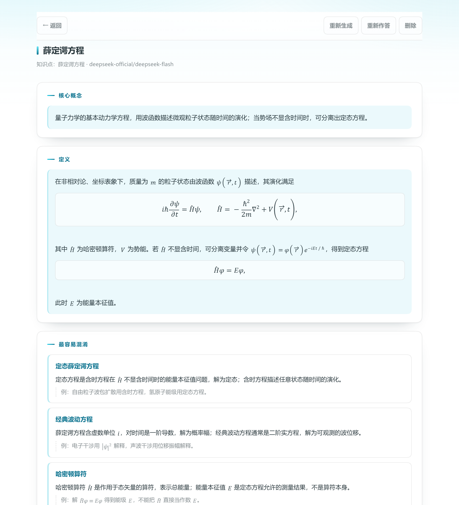

# Review Desk · dsh-review-desk

[](https://github.com/zakeluo/dsh-review-desk/actions/workflows/ci.yml)
[](LICENSE)
[](CHANGELOG.md)

A DSH sidebar plugin: type any topic, and the host default model plus live web search turns it into a flashcard (core concept / definition / common confusions) with 3–5 self-test questions. Answers are scored automatically, and wrong answers are tracked locally per topic.



> Screenshot from a real local run, cropped to the plugin pane. Replace it with your own before publishing — see [Pre-release checklist](#pre-release-checklist).

## Features

- **Card generation** — enter a topic (≤ 60 chars); the host default model, grounded on web search results, writes a card: a one-line concept, a rigorous definition, 1–3 confusions, and 3–5 questions.
- **Source citations** — the card keeps retrieved page titles/URLs (`sources`) and flags whether it was grounded (`grounded`).
- **Scoring and wrong-answer book** — answers are scored with explanations; wrong answers accumulate per topic (best / latest score) and can be retried from the "Wrong" view.
- **Local storage** — cards, stats and optional model override stay on your machine. Nothing is uploaded.
- **Zero dependencies** — no runtime npm dependencies; `webServer`, `llm` and everything else is injected by the DSH host.
- **Cache and regenerate** — the same topic reuses the stored card (`cached: true`) unless you force a regeneration (`force: true`).
- **Native formula rendering** — the generation prompt requires standard LaTeX (inline `$…$`, core formulas as `$$…$$` on their own centered line, integrals with limits, Greek letters, complex exponentials, fractions, operators); the panel converts LaTeX to MathML and renders it with the browser's built-in MathML Core — no external fonts or CDN.
- **Chemical equations and mechanisms** — reaction-type topics include a balanced example equation (correct element casing, subscripts, ionic charges as superscripts, `(g)(l)(s)(aq)` states, `->` / `<=>`, conditions above/below the arrow, `↑` `↓` markers) and mechanism-type topics include a step-by-step mechanism. Equations are written in mhchem `\ce{...}` syntax and rendered structurally by the same dependency-free converter — no mhchem, no KaTeX. See [`docs/screenshot-chemistry.png`](docs/screenshot-chemistry.png) (pericyclic reaction: bond symbols, a `Δ` condition, a `‡` transition state and a step-by-step mechanism).
- **Theme-aware UI** — inherits the DSH light/dark theme; icon row in the sidebar and a full panel in the main area.

## Requirements

- DSH `>= 0.2.1-rc.3 < 0.3.0` (Desktop or Web).
- A selected default model (the plugin generates through the host default model; you can override it with `config.json`, see [Data and privacy](#data-and-privacy)).
- Node.js ≥ 20 — only for development and tests, not at runtime.

## Installation

### Option 1: plugin manager (recommended)

1. Open the **Plugins** panel in DSH.
2. Choose to install a local plugin (`install_bundle` in the plugin manager) and point `target` at this repository directory (the folder containing `package.json`).
3. **Restart DSH** afterwards (or wait for the host hot-reload). Installing without a reload usually leaves the sidebar entry missing.

### Option 2: CLI

```powershell
dsh plugin --profile <profile> add "file:D:/path/to/dsh-review-desk"
```

- Replace `<profile>` with your profile name (e.g. `desktop`).
- Replace the path with the actual repository location.
- **Restart DSH** (or wait for hot-reload) so the new code is loaded.

Once loaded, the sidebar shows **Review Desk**. You can confirm the host half is mounted with `GET /dsh-review-desk/api/health`:

```json
{ "ok": true, "version": "0.2.0", "model": "deepseek-official/deepseek-flash", "dataDir": "~/.dsh/data/review-desk", "cards": 3 }
```

`dataDir` is shown as `~/.dsh/data/review-desk`; the absolute local path is never exposed.

## Usage

1. Click **Review Desk** in the sidebar.
2. Type a topic (≤ 60 chars) or click an example chip (Newton's rings, electrophilic addition, Lagrange mean value theorem, molecular orbital theory, entropy increase, Fourier transform).
3. Click **Generate** and wait for search + generation (typically 20–60 seconds; the endpoint times out at 200 seconds).
4. Answer the questions and click **Submit (n/m)** to see the score and per-question explanations.
5. The top-right **Wrong n** button opens the wrong-answer book; **Recent** lists existing cards to revisit.
6. **Regenerate** (force) and **Try again** (reset the current answers) are available in the card header.

## HTTP API

All seven endpoints are mounted by the host half under the DSH web server prefix `/dsh-review-desk/api`:

| Method | Path | Description |
| --- | --- | --- |
| GET | `/health` | `{ ok, version, model, dataDir, cards }` — version, active model, data directory and card count |
| POST | `/generate` | body `{ topic, force? }` → `{ card, cached, tookMs, pruned }`; `force: true` bypasses the cache |
| GET | `/library` | `{ cards: [{ topic, title, questionCount, best, total, at }], total }`, newest first (legacy `questions` / `createdAt` aliases kept) |
| GET | `/card?topic=` | single card matched by topic or title; 404 when absent |
| POST | `/attempt` | body `{ topic, items: [{ i, correct }] }` (1–20 items) → `{ total, correct, score, attempts, best }`, records stats |
| GET | `/wrong` | `{ rows }` — topics whose latest attempt had wrong answers, newest first |
| POST | `/delete` | body `{ topic }` → removes the card and cascades its stats record, returns `{ removed, statsRemoved }` |

Request guards and edge behavior (evaluation order: `403 cross-site → 404 unknown route → 405 method → 415 Content-Type → 413 size → 400 params/JSON`):

- **Cross-site requests → 403** — rejected when `sec-fetch-site: cross-site`, or when `Origin` cannot be parsed / is `null` / does not match the request `Host` (`cross-site request rejected`).
- **Non-JSON → 415** — `POST` requests whose `Content-Type` is not `application/json` (parameters such as `; charset=utf-8` are allowed).
- **Oversized body → 413** — bodies above 256 KiB are rejected before business logic.
- **Wrong method → 405** — with an `Allow` header and `method not allowed`.
- **Invalid JSON → 400** — unparsable bodies, or JSON whose top level is not a plain object (`null` / array / string / number).
- **Bad parameters → 400** — missing topic, topic longer than 60 chars, `/attempt` items not an array of 1–20 valid entries, etc.
- **Generation failure → 502** — search or model errors are returned as an error message and shown as a red banner in the UI.
- **Generation timeout → 504** — the whole `/generate` operation (search + model call) defaults to 200 seconds; on timeout it returns `生成超时`.
- **Corrupt data files are quarantined** — if `library.json` / `stats.json` cannot be parsed (or have the wrong shape), the file is renamed to `<name>.corrupt-<ISO timestamp>` and the plugin continues with empty data instead of failing to boot.
- **Serialized writes** — every read-modify-write goes through one serial queue with a temp file + atomic `rename`, so concurrent requests cannot lose updates.
- **At most 120 cards** — the oldest card is dropped when the limit is exceeded; the response reports the number dropped as `pruned`. Regenerating a topic replaces the card in place.

## Data and privacy

- Data directory: `~/.dsh/data/review-desk/` (`$DSH_HOME/data/review-desk` when `DSH_HOME` is set).
- `library.json` — cards (questions, confusions, source links, model used).
- `stats.json` — per-topic attempt count, best score, latest score and wrong-answer indices.
- `config.json` (optional) — `{ "provider": "...", "model": "..." }` to override the host default model.
- During generation the **topic** and the **retrieved web snippets** are sent to the host's current default model; search queries go to Sogou (sogou.com) and 360 Search (so.com).
- There is no backend server and no telemetry. The plugin API is bound to the local DSH web server; do not expose that port to the internet.

## Development

```powershell
# Runtime has zero dependencies; install only creates/updates the lock file (optional)
npm install --no-audit --no-fund

# Syntax check: node --check lib/index.js && node --check lib/client.js
npm run check

# Unit tests: node --test tests/
npm test

# check + test
npm run lint
```

- Node.js ≥ 20, pure ESM (`"type": "module"`).
- The host side (`lib/index.js`) registers an HTTP prefix with the Cordis plugin API; the browser side (`lib/client.js`) exports through the `window.__ModuleLoader__` factory format.
- Tests must point `DSH_HOME` at a temporary directory and must not touch the real user data directory.

## Project layout

```text
dsh-review-desk/
├── package.json           # manifest: bundle patch / client / locale / icon / exports
├── cordis.patch.yml       # bundle patch: inserts the plugin into the profile stack
├── lib/
│   ├── index.js           # host side: Cordis plugin + 7 HTTP endpoints
│   └── client.js          # browser side: main panel + sidebar entry
├── locale/
│   ├── en.json            # English display metadata (meta.title / meta.description)
│   └── zh.json            # Chinese display metadata
├── assets/icon.svg        # plugin icon (≤ 256 KiB, shipped with the package)
├── tests/                 # node:test suites
├── docs/                  # screenshots and publishing notes
├── .github/workflows/ci.yml
├── CHANGELOG.md
├── SECURITY.md
├── CONTRIBUTING.md
└── LICENSE
```

## Known limitations / roadmap

- **No standalone auth** — relies on the local-access model of the DSH web server plus the request guards above; never expose the port publicly.
- **No spaced repetition yet** — the wrong-answer book stores best/latest scores and wrong indices, but no SM-2 / FSRS scheduling.
- **Search depends on third-party HTML** — Sogou / 360 markup changes can make retrieval empty; generation then falls back to textbook knowledge (`grounded: false`).
- **120-card library cap**, topics limited to 60 chars.
- **Generation quality depends on the selected model**; explanations are study aids, not authoritative references.

## Pre-release checklist

The GitHub username appears as a placeholder throughout the repo (no real username is invented). Replace it before publishing (an automated script is provided in [docs/PUBLISHING.md](docs/PUBLISHING.md)):

| Location | Action |
| --- | --- |
| `package.json` | 3 places: `repository.url`, `homepage`, `bugs.url` |
| `README.md` | 2 CI badge links; any other repository links |
| `README.en.md` | same as above |
| `CHANGELOG.md` | 2 places: version compare link and Release link at the bottom |
| `SECURITY.md` | 1 place: GitHub security advisory link |
| `docs/PUBLISHING.md` | example repository URLs |
| `docs/screenshot.png` | optionally replace with your own screenshot (current one is a real local run, cropped to the plugin pane) |
| `docs/screenshot-chemistry.png` | optional chemistry card screenshot (also a real local run, sidebar cropped out) |
| GitHub | create the repository, push tag `v0.2.0`, and publish a Release (notes can come from `CHANGELOG.md`) |

See [docs/PUBLISHING.md](docs/PUBLISHING.md) for the full sequence.

## Contributing

- Run `npm run lint` before pushing.
- See [CONTRIBUTING.md](CONTRIBUTING.md) for the dev setup, style rules and the contracts that must not break.
- Report security issues privately per [SECURITY.md](SECURITY.md); please do not open a public issue.

## License

[MIT](LICENSE) © 2026 dsh-review-desk contributors
