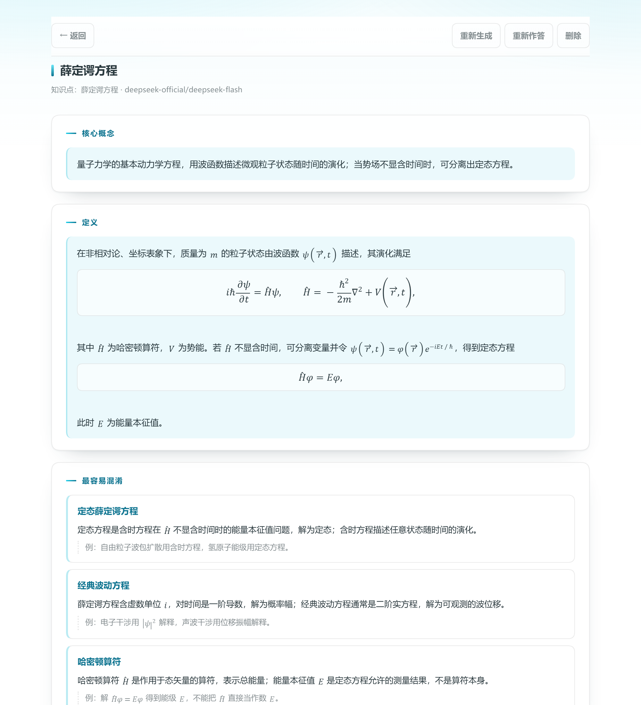

# 复习台 · dsh-review-desk

[](https://github.com/zakeluo/dsh-review-desk/actions/workflows/ci.yml)
[](LICENSE)
[](CHANGELOG.md)

DSH 侧栏插件：输入任意知识点，由宿主默认模型结合联网检索生成一张复习卡（核心概念 / 定义 / 易混辨析）和 3–5 道自测题；作答后自动判分，错题按知识点记在本机。



> 截图来自本机实际运行，已裁掉 DSH 侧栏其它内容。发布前可替换为自己的截图，见 [发布前替换](#发布前替换维护者)。

## 功能特性

- **生成复习卡**：输入一个知识点（≤ 60 字），宿主用当前默认模型 + 联网检索结果生成卡片：一句话核心概念、严谨定义、1–3 个易混辨析、3–5 道自测题。
- **来源引用**：卡片保留检索到的网页标题与链接（`sources`），并用 `grounded` 标注本次是否有检索资料。
- **判分与错题本**：作答后自动判分并给出解析；错题按知识点累计（最好成绩 / 最近成绩），「错题」页可一键重做。
- **本地存储**：卡片、作答统计、可选的模型覆盖都只写本机数据目录，不上传任何数据。
- **零依赖**：运行时不需要任何 npm 依赖，`webServer`、`llm` 等能力全部由 DSH 宿主注入。
- **缓存与重生成**：同一知识点默认复用已有卡片（`cached: true`），也可强制重新生成（`force: true`）。
- **公式原生渲染**：生成提示词强制模型用标准 LaTeX 书写（行内 `$…$`、核心公式 `$$…$$` 单独居中成行、积分带上下限、希腊字母、复指数、分式、算子等），面板内置零依赖 LaTeX→MathML 转换器，用浏览器原生 MathML Core 渲染，不需要外部字体或 CDN。
- **化学式与反应式**：涉及化学反应的知识点会给出配平的示例反应式（元素符号大小写、下标、离子电荷上标、`(g)(l)(s)(aq)` 状态、`->` / `<=>`、箭头上下条件、`↑` `↓` 标注），机理类知识点额外给出分步机理；反应式用 mhchem 的 `\ce{...}` 语法书写，由同一个零依赖转换器渲染成结构化公式，不引入 mhchem 或 KaTeX。效果见 [`docs/screenshot-chemistry.png`](docs/screenshot-chemistry.png)（周环反应：成键符号、`Δ` 反应条件、过渡态 `‡` 与分步机理）。
- **跟随主题**：面板颜色继承 DSH 明暗主题；侧栏为 icon 行，主面板为完整复习界面。

## 环境要求

- DSH `>= 0.2.1-rc.3 < 0.3.0`（Desktop 或 Web 版均可）。
- 一个已选中的默认模型（插件通过宿主默认模型生成内容；也可在数据目录用 `config.json` 覆盖，见[数据与隐私](#数据与隐私)）。
- Node.js ≥ 20 —— 仅开发和跑测试需要，运行时不需要。

## 安装

### 方式一：插件管理器（推荐）

1. 在 DSH 里打开「插件」面板。
2. 选择安装本地插件（plugin manager 的 `install_bundle`），target 选本仓库目录（即含 `package.json` 的那一层）。
3. 安装完成后**重启 DSH**（或等宿主热加载该插件）——只安装不重启通常看不到侧栏入口。

### 方式二：CLI

```powershell
dsh plugin --profile <profile> add "file:D:/path/to/dsh-review-desk"
```

- 把 `<profile>` 换成你的 profile 名（例如 `desktop`）。
- 把 `D:/path/to/dsh-review-desk` 换成仓库实际路径。
- 安装后同样需要**重启 DSH**（或等 host 热加载），新代码才会生效。

安装成功后，侧栏出现「复习台」；`GET /dsh-review-desk/api/health` 会返回当前模型与数据目录，可用来确认宿主半侧已挂载：

```json
{ "ok": true, "version": "0.2.0", "model": "deepseek-official/deepseek-flash", "dataDir": "~/.dsh/data/review-desk", "cards": 3 }
```

`dataDir` 以 `~` 形式展示，不会泄露本机绝对路径。

## 使用

1. 点击侧栏「复习台」。
2. 输入知识点（≤ 60 字），或点示例胶囊（牛顿环、亲电加成、拉格朗日中值定理、分子轨道理论、熵增原理、傅里叶变换）。
3. 点「生成」，等待检索与出题（通常 20–60 秒；生成端点整体超时 200 秒）。
4. 在卡片中逐题作答，点「提交判分（n/m）」查看得分与每题解析。
5. 顶部「错题 n」进入错题本；「最近复习」列出已有卡片，点击即可复习。
6. 卡片右上角可「重新生成」（`force`），或「重新作答」重置本题作答。

## HTTP API

宿主半侧把 7 个端点挂在 DSH web server 的前缀 `/dsh-review-desk/api` 下：

| 方法 | 路径 | 说明 |
| --- | --- | --- |
| GET | `/health` | 返回 `{ ok, version, model, dataDir, cards }`：版本、当前生效模型、数据目录与卡片数 |
| POST | `/generate` | 请求 `{ topic, force? }`，返回 `{ card, cached, tookMs, pruned }`；`force: true` 跳过缓存重新生成 |
| GET | `/library` | 卡片列表 `{ cards: [{ topic, title, questionCount, best, total, at }], total }`，按创建时间倒序（兼容旧字段 `questions` / `createdAt`） |
| GET | `/card?topic=` | 取单张卡片（按知识点或标题匹配），未找到返回 404 |
| POST | `/attempt` | 请求 `{ topic, items: [{ i, correct }] }`（1–20 项），判分并写入统计，返回 `{ total, correct, score, attempts, best }` |
| GET | `/wrong` | 错题本 `{ rows }`：最近一次作答有错的知识点，按时间倒序 |
| POST | `/delete` | 请求 `{ topic }`，删除该知识点的卡片与统计（级联删除 stats 记录），返回 `{ removed, statsRemoved }` |

请求守卫与边界行为（判定顺序：`403 跨站 → 404 未知路由 → 405 方法 → 415 Content-Type → 413 体积 → 400 参数/JSON`）：

- **跨站请求 → 403**：`sec-fetch-site: cross-site`，或 `Origin` 无法解析 / 为 `null` / 与请求 `Host` 不一致时，直接拒绝（`cross-site request rejected`）。
- **非 JSON → 415**：`POST` 的 `Content-Type` 不是 `application/json`（允许带 `; charset=utf-8` 等参数）时拒绝。
- **超大请求 → 413**：请求体超过 256 KiB 时直接拒绝，不进入业务逻辑。
- **方法不匹配 → 405**：返回 `Allow` 头与 `method not allowed`。
- **非法 JSON → 400**：请求体解析失败，或顶层不是普通对象（`null` / 数组 / 字符串 / 数字）时拒绝。
- **参数错误 → 400**：缺少知识点、知识点超过 60 字、`/attempt` 的 `items` 不是 1–20 项的数组或全部非法等。
- **生成失败 → 502**：检索或模型调用失败时返回错误信息，前端展示为红色提示。
- **生成超时 → 504**：单次 `/generate`（检索 + 出题）整体超时默认 200 秒，超时返回 `生成超时`。
- **数据文件损坏自动隔离**：`library.json` / `stats.json` 解析失败（或顶层结构不对）时，坏文件改名为 `<文件名>.corrupt-<ISO 时间戳>` 备份，并以空数据继续，不会让插件启动失败。
- **并发写串行化**：所有“读—改—写”走同一条串行队列 + 临时文件 + 原子 `rename`，并发请求不会互相覆盖。
- **卡片库上限 120 张**：超出时丢弃最早的卡片，响应里用 `pruned` 告知本次丢弃数量；同一知识点生成会原位覆盖。

## 数据与隐私

- 数据目录：`~/.dsh/data/review-desk/`（设置了 `DSH_HOME` 时为 `$DSH_HOME/data/review-desk`）。
- `library.json`：复习卡（含题、辨析、来源链接、所用模型）。
- `stats.json`：每个知识点的作答次数、最好成绩、最近成绩与错题下标。
- `config.json`（可选）：`{ "provider": "...", "model": "..." }`，用来覆盖宿主默认模型。
- 生成时会把**知识点**和**检索到的网页片段**发给宿主当前默认模型；检索请求发往搜狗（sogou.com）与 360 搜索（so.com）。
- 没有自建服务器、没有遥测；插件 API 挂在本机 DSH web server 上，默认仅供本机访问。请不要把该端口暴露到公网。

## 开发

```powershell
# 运行时零依赖，install 只是生成/更新 lock 文件（可跳过）
npm install --no-audit --no-fund

# 语法检查：node --check lib/index.js && node --check lib/client.js
npm run check

# 单元测试：node --test tests/
npm test

# check + test
npm run lint
```

- Node.js ≥ 20，纯 ESM（`"type": "module"`）。
- 宿主侧 `lib/index.js` 用 Cordis 插件 API 注册 HTTP 前缀；浏览器侧 `lib/client.js` 用 `window.__ModuleLoader__` 工厂格式导出。
- 测试必须把 `DSH_HOME` 指向临时目录，禁止读写真实用户数据目录。

## 目录结构

```text
dsh-review-desk/
├── package.json           # 插件清单：bundle patch / client / locale / icon / exports
├── cordis.patch.yml       # bundle patch：把插件插入 profile 层栈
├── lib/
│   ├── index.js           # 宿主侧：Cordis 插件 + 7 个 HTTP 端点
│   └── client.js          # 浏览器侧：main 面板 + 侧栏「复习台」
├── locale/
│   ├── en.json            # 英文展示元数据（meta.title / meta.description）
│   └── zh.json            # 中文展示元数据
├── assets/icon.svg        # 插件图标（≤ 256 KiB，随包分发）
├── tests/                 # node:test 用例
├── docs/                  # 截图与发布说明
├── .github/workflows/ci.yml
├── CHANGELOG.md
├── SECURITY.md
├── CONTRIBUTING.md
└── LICENSE
```

## 已知限制 / 路线图

- **无独立鉴权**：依赖 DSH web server 的本机访问模型与请求守卫，不要把端口暴露到公网。
- **没有间隔重复**：错题本只记录最好/最近成绩与错题下标，尚未实现 SM-2 / FSRS 调度。
- **检索依赖第三方 HTML**：搜狗 / 360 改版可能导致检索为空；此时会退化为“基于教材通识出题”，仍能生成卡片但 `grounded: false`。
- **卡片库上限 120 张**，知识点最长 60 字。
- **生成质量取决于所选模型**，题目解析仅供复习参考。

## 发布前替换（维护者）

仓库中的 GitHub 用户名以占位符表示（未编造真实用户名），公开发布前需按下表统一替换（自动替换脚本见 [docs/PUBLISHING.md](docs/PUBLISHING.md)）：

| 位置 | 需要做的事 |
| --- | --- |
| `package.json` | 3 处：`repository.url`、`homepage`、`bugs.url` |
| `README.md` | CI badge 链接 2 处；如需其它仓库链接一并替换 |
| `README.en.md` | 同上 |
| `CHANGELOG.md` | 2 处：文末的版本对比链接与 Release 链接 |
| `SECURITY.md` | 1 处：GitHub 安全公告链接 |
| `docs/PUBLISHING.md` | 示例仓库地址 |
| `docs/screenshot.png` | 可替换为自己的运行截图（当前为本机实际截图裁掉侧栏） |
| `docs/screenshot-chemistry.png` | 可选：化学卡片截图（同为真实运行截图，裁掉侧栏） |
| GitHub | 创建仓库后打真实 tag `v0.2.0` 并发布 Release（Release notes 可直接取自 `CHANGELOG.md`） |

完整步骤见 [docs/PUBLISHING.md](docs/PUBLISHING.md)。

## 参与贡献

- 提交前请跑 `npm run lint`。
- 开发环境、代码风格与不允许破坏的契约见 [CONTRIBUTING.md](CONTRIBUTING.md)。
- 安全问题请按 [SECURITY.md](SECURITY.md) 私密报告，不要开公开 issue。

## License

[MIT](LICENSE) © 2026 dsh-review-desk contributors
